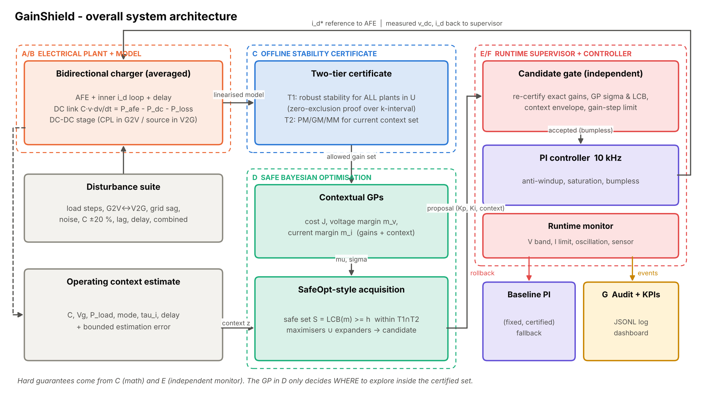
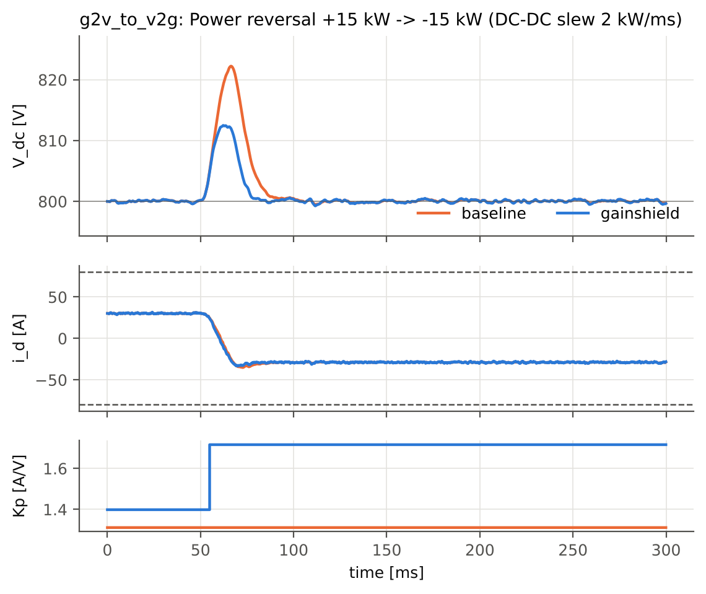

# GainShield

**AI-driven safe Bayesian PI gain tuning with stability certification and runtime fallback for a
bidirectional EV-charger DC-link voltage controller** (simulation proof of concept, TECHgium 10th Edition).



GainShield tunes the DC-link voltage PI controller of a bidirectional (G2V/V2G) charger online, but the learning
part never holds a safety guarantee:

1. **Certificate (math, offline + exact re-check).** Every gain pair ever applied is *proved* robustly stable for
   all plants in the uncertainty set (C ±20 %, grid 0.8–1.1 pu, both power directions; zero-exclusion proof over
   the loop-gain interval at 88 inner-loop-lag × delay nodes), and meets PM/GM/modulus margins for the current
   operating context.
2. **Safe Bayesian optimisation (AI).** Contextual Gaussian processes model cost, voltage margin and current
   margin; a SafeOpt-style acquisition explores only where the GP lower confidence bound says the margins hold.
3. **Independent supervisor.** A candidate gate re-certifies the exact gains, checks GP confidence, the context
   envelope and a gain-step limit; a 10 kHz runtime monitor rolls back to the certified manual baseline
   (bumpless) on voltage, current, oscillation or sensor anomalies.
4. **Audit.** Every proposal, acceptance, rejection and rollback is logged as JSONL with reasons.

## Results (simulation, generated by `experiments/run_all.py`)

| | Manual PI (baseline) | GainShield |
|---|---|---|
| Mean peak DC-link deviation, 11 scenarios × 5 seeds | 2.03 % | **1.69 %** (−15.6 %, p = 3.6e-8) |
| Mean IAE | 0.316 V·s | **0.270 V·s** (−14.9 %) |
| Mean settling time (±0.5 % band) | 56.9 ms | **54.9 ms** (−7.9 %) |
| Current-reference ripple (noise amplification) | 1.67 A | 1.78 A (+8.5 %, the price) |
| Power reversal G2V→V2G peak deviation | 2.79 % | **1.54 %** (−45 %) |
| Time outside ±5 % band / trips / current violations | 0 / 0 / 0 | 0 / 0 / 0 |
| Probe episodes during online tuning outside ±5 % | – | 0 of 175 |
| Injected unstable gains (gate bypassed) | – | detected, rolled back, peak 3.9 % |

GainShield stays on the baseline where it has no certified, GP-supported improvement (20 kW grid sag, slow inner
loop, combined stress) – it is never worse there. Full tables: [EVALUATION_REPORT](docs/EVALUATION_REPORT.md),
[ABLATION_REPORT](docs/ABLATION_REPORT.md), [FAILURE_ANALYSIS](docs/FAILURE_ANALYSIS.md).



## Quick start

```bash
python -m venv .venv && source .venv/bin/activate
pip install -r requirements.txt
pytest -q                               # 36 tests
python experiments/run_all.py           # regenerate everything (~15 min, CPU only)
streamlit run dashboard/app.py          # dashboard
```

Python ≥ 3.11. No GPU, MATLAB or internet needed. See [DEMO_GUIDE](docs/DEMO_GUIDE.md).

## Repository layout

```
config/default.toml        every parameter (engineering assumptions A-1..A-15)
gainshield/                package
  plant/charger.py           averaged AFE + DC link + DC-DC model (RK4, fractional delay)
  controllers/               PI (anti-windup, bumpless) + symmetric-optimum baseline
  disturbances/scenarios.py  seeded disturbance suite (10 classes)
  stability/                 exact discrete loop model, two-tier certificate
  optimizer/                 GP wrapper, contextual safe BO
  safety/supervisor.py       candidate gate + runtime monitor
  audit/logger.py            JSONL audit log
  evaluation/                metrics, plots
  core.py                    tuning sessions and deployed agent
experiments/               reproducible scripts (certificate, tuning, evaluation, failures, ablation, reports)
dashboard/app.py           Streamlit dashboard
tests/                     pytest unit + integration tests
diagrams/                  six architecture diagrams (generated SVG/PNG + source script)
docs/                      model, architecture, assumptions, reports, traceability, HIL roadmap, costs, limits
results/                   generated data, figures, audit logs
```

## Documentation

[Mathematical model](docs/MATHEMATICAL_MODEL.md) · [Architecture](docs/ARCHITECTURE.md) ·
[Assumptions](docs/ASSUMPTIONS.md) · [Requirement traceability](docs/REQUIREMENTS_TRACEABILITY.md) ·
[HIL roadmap](docs/HIL_ROADMAP.md) · [Cost estimate](docs/COST_ESTIMATE.md) ·
[Limitations](docs/LIMITATIONS.md) · [References](docs/REFERENCES.md) · [Stage-1 analysis](docs/STAGE1_ANALYSIS.md)

## Honest scope

Simulation only. All parameters are assumptions (the problem statement gives none). The stability
certificate covers the linearised model inside the stated uncertainty set; the SafeOpt theoretical guarantee
is not claimed. A stuck voltage sensor is a known undetected failure mode. No HIL or hardware tests have been
performed – see [LIMITATIONS](docs/LIMITATIONS.md).

## Git hygiene

Commit source, configs, docs and `results/` (small, < 20 MB). Do not commit `.venv/` or credentials. Suggested
history: one commit per stage (model → certificate → optimiser → supervisor → experiments → docs).
