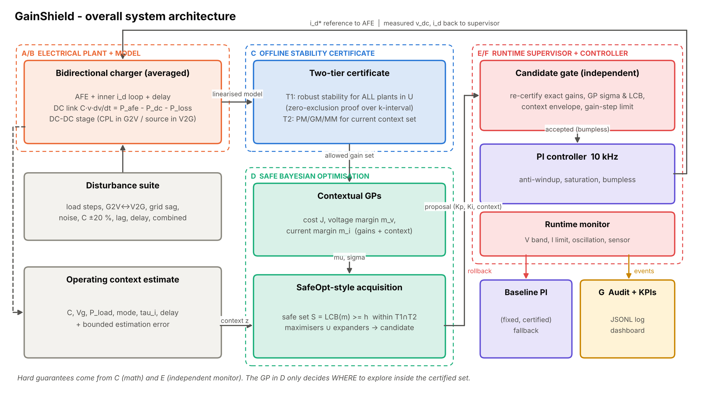
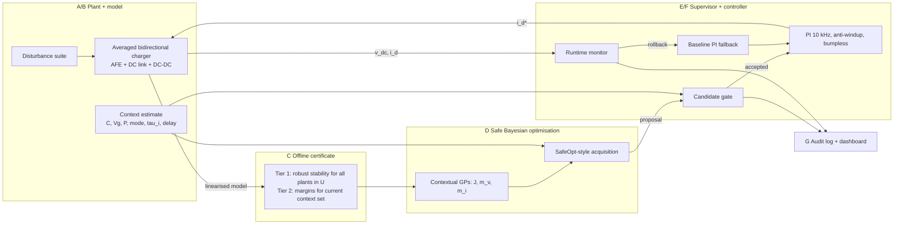

# Architecture

The architecture was designed from the requirements, not copied from the initial sample diagram. Its central
idea: **the learning component never holds a safety guarantee.** Guarantees come from mathematics (Layer C,
offline) and from an independent runtime monitor (Layer E). The GP-based optimiser (Layer D) only decides
*where inside the certified set* to explore and which certified gains to deploy for the current context.

## Layer → module map

| Layer | Responsibility | Module(s) | Merged / reorganised because |
|---|---|---|---|
| A Electrical plant | AFE, DC link, DC-DC, measurements, limits | `plant/charger.py` | A and B are one averaged model in software |
| B Model + context | parameters, operating point, C variation, lag, delay, CPL, G2V/V2G | `plant/charger.py`, `config.py`, `simulation.ContextEstimate` | context is a plain data object passed to D and E |
| C Certification | linearisation, char. polynomial, gain regions, uncertainty | `stability/linear_model.py`, `stability/certify.py` | |
| D Safe BO | DoE, GPs, acquisition, bounds, updates | `optimizer/gp.py`, `optimizer/safe_bo.py` | |
| E Supervisor | candidate validation, monitors, confidence, envelope, rollback trigger | `safety/supervisor.py` | gate and monitor kept separate from D on purpose |
| F Execution | PI, anti-windup, saturation, bumpless, baseline, fallback | `controllers/pi.py`, `controllers/baseline.py`, `core.py` agents | |
| G Observability | audit, KPIs, dashboard, comparison, failure analysis | `audit/logger.py`, `evaluation/`, `dashboard/app.py`, `experiments/` | |

## Two operating modes

1. **Online tuning session** (`GainShield.tune_context`): for the current context, propose → gate → probe
   episode on the plant under the monitor → update GPs → repeat; ends with a recommendation.
2. **Deployed control** (`GainShieldAgent`): at start and whenever the context changes (|ΔVg| > 0.05 pu,
   |ΔP| > 3 kW or mode change, after a 5 ms dwell), query the recommendation, gate it, apply bumplessly.
   The monitor runs every sample; an alarm rolls back to the baseline and locks adaptation for 100 ms.

## Diagrams

| # | File | Content |
|---|---|---|
| 1 | `diagrams/01_system_architecture.svg` | overall layered architecture |
| 2 | `diagrams/02_ai_optimisation_flow.svg` | one safe-BO iteration |
| 3 | `diagrams/03_runtime_safety_fallback.svg` | gate checks, monitor, rollback |
| 4 | `diagrams/04_electrical_block_diagram.svg` | averaged electrical model and signals |
| 5 | `diagrams/05_data_flow.svg` | files and artefacts |
| 6 | `diagrams/06_software_modules.svg` | package structure |

All six are generated by `python diagrams/make_diagrams.py` (editable source).
